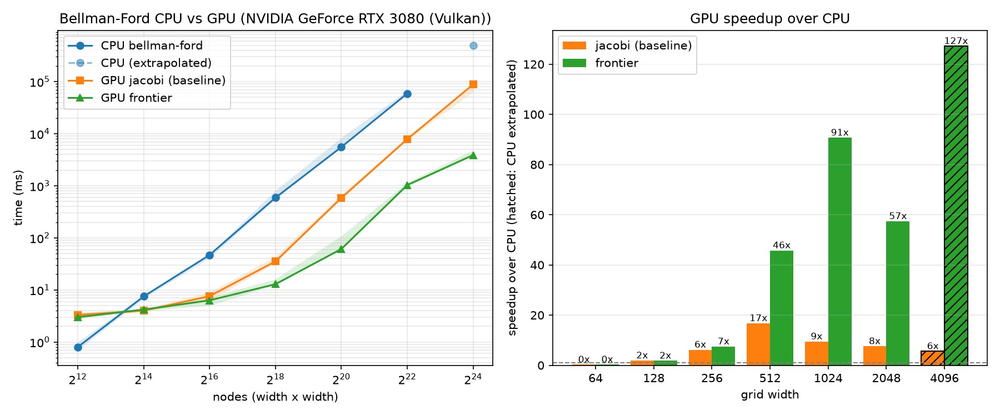

+++
date = '2025-10-25T14:17:30-04:00'
draft = false
title = 'Bellman-Ford on GPU'
tags = ['gpu', 'wgpu', 'rust', 'graph']
categories = ['gpu', 'project']
summary = 'Notes from testing a graph-based approach to a problem: CSR layout, a Jacobi-style pull Bellman-Ford, and a push version with atomics and a frontier.'
showToc = true
TocOpen = true
cover = { image = 'thumbnail.jpg' }
+++

## Context

Recently looking at a problem where a graph-based solution seemed like a fit, I wanted to poke at it through a toy project before committing to anything. Picked Bellman-Ford as a test bed because unlike Dijkstra and its priority queue approach, BF is more GPU-friendly.

Using Rust with [wgpu](https://wgpu.rs) to run wgsl compute shaders on my RTX 3080, I tested three implementations:

1. CPU baseline for Bellman-Ford
2. a pull-based version on the GPU, Jacobi style
3. a push-based version on the GPU with a frontier approach so it stops relaxing the whole graph every pass

## Graph data layout

The graph data layout, to be gpu-friendly, follow a common approach that can be seen for sparse matrix called CSR (Compressed Sparse Row, used to compress matrices with sparse non-zero values). It made me think of a prefix sum of the node degrees.

```rust
// row_ptrs[i]..row_ptrs[i+1] tells you where node i's edges live
// neighbors[k] and weights[k] are the destination and cost of edge k

let mut row_ptrs = vec![0; n_nodes + 1];
for &(from, _, _) in edges {
    row_ptrs[from + 1] += 1; // count edges leaving each node
}
for i in 1..=n_nodes {
    row_ptrs[i] += row_ptrs[i - 1]; // prefix sum
}
```

## The CPU baseline

Relaxation happens in place, an update is immediately visible to every node visited after it in the same sweep, so improvements cascade down the sweep instead of waiting a full pass like the Jacobi kernel. It expects the graph in reversed form.

```rust
pub fn bellman_ford(graph: &CsrGraph, source: usize) -> Vec<f32> {
    let n = graph.n_nodes();
    let mut dist = vec![f32::INFINITY; n];
    dist[source] = 0.0;

    for _ in 0..n.saturating_sub(1) {
        let mut changed = false;
        for v in 0..n {
            let old = dist[v];
            let mut best = old;
            for (u, cost) in graph.row(v) {
                best = best.min(dist[u] + cost);
            }
            if best < old {
                dist[v] = best;
                changed = true;
            }
        }
        if !changed {
            return dist;
        }
    }
    dist
}
```

## Pull on the GPU, Jacobi style

Each invocation owns one node `v`, reads the old distances of its in-neighbors, writes its new distance into a second buffer. Reads and writes never mix: everything reads `dist_old`, everything writes `dist_new`. No synchronization needed inside a sweep because of the ping-ponging between the two buffers. Since every node looks at what flows *into* it, this one wants the graph in reversed form.

```rust
// Bindings: row_ptrs, neighbors, weights, dist_old (read-only),
// dist_new + a changed flag (read_write).
@compute @workgroup_size(64)
fn main(@builtin(global_invocation_id) id: vec3<u32>) {
    let v = id.x + id.y * MAX_X_NODES; // spill into y past the workgroup cap
    if (v >= arrayLength(&dist_new)) {
        return;
    }
    var best = dist_old[v];
    let start = row_ptrs[v];
    let end = row_ptrs[v + 1u];
    for (var k = start; k < end; k = k + 1u) {
        let u = neighbors[k];
        best = min(best, dist_old[u] + weights[k]);
    }
    dist_new[v] = best;
    if (best < dist_old[v]) {
        atomicOr(&changed, 1u);
    }
}
```

What ended up mattering more than I expected is the host loop. One pass advances the frontier by exactly one hop, and the sweep re-reads every edge of the graph the whole way. The work near the source is done after a couple of passes, but the sweep can't know that. It's a lot of wasteful computations.

Also, checking convergence means a sync: reading the `changed` flag drains the queue back to the host, exactly the kind of stall you want a GPU workflow to avoid. I batch `check_every` passes between checks, which cuts the syncs by that factor at the cost of overshooting convergence by a few passes. Reasonable trade, and it makes it a little faster, but the bottleneck is clearly relaxing all the graph each sweep.

## Push on the GPU, atomics and a frontier

The Jacobi version had this bitter taste of wasteful computation. So the second version flips the edge directions: a node pushes improvements along its out-edges, in place, into a single distance buffer.

Two things to be careful about. First, threads now race with each other, so updates have to go through atomics, and WGSL has no `f32` atomics.. it would have been too sweet. Distances are stored as raw bit patterns and compared through an order-preserving key, which is a nice trick for comparing the values with integer atomics.

```wgsl
// WGSL only supports atomic operations on integers, so we need to convert f32 to u32
// f32 are stored as follows: | sign 1 bit | exponent 8 bits | mantissa 23 bits |
// The mapping preserves order (not value)
fn sort_key(b: u32) -> u32 {
    // If the sign bit is 0, the f32 is positive, and the key is the same as the bit pattern
    if ((b & 0x80000000u) == 0u) {
        return b | 0x80000000u;
    }

    // flip all bits, so that the largest negative f32 has the smallest key
    return ~b;
}
```

Second, with everyone relaxing in place there's no clean "this pass is done" moment. So the frontier is tracked implicitly: each node remembers the distance it last relaxed from (`last_relaxed`) and skips the pass unless its distance improved since. Nodes that didn't change do almost nothing, one atomic load and out. And because updates are visible immediately, one pass can cascade an improvement through several hops, something the Jacobi version could never do. It's not deterministic though because the thread order cannot be predicted.

```wgsl
@compute @workgroup_size(64)
fn main(@builtin(global_invocation_id) id: vec3<u32>) {
    let v = id.x + id.y * MAX_X_NODES;
    if (v >= arrayLength(&dist)) {
        return;
    }

    let d = atomicLoad(&dist[v]);
    if (sort_key(d) >= sort_key(atomicLoad(&last_relaxed[v]))) {
        return;
    }
    atomicStore(&last_relaxed[v], d);

    let dv = bitcast<f32>(d);
    let start = row_ptrs[v];
    let end = row_ptrs[v + 1u];
    for (var k = start; k < end; k = k + 1u) {
        let u = neighbors[k];
        let nd = dv + weights[k];
        let nd_key = sort_key(bitcast<u32>(nd));
        var old = atomicLoad(&dist[u]);

        // Float min via compare-exchange on the order-preserving keys.
        loop {
            if (nd_key >= sort_key(old)) {
                break;
            }
            let res = atomicCompareExchangeWeak(&dist[u], old, bitcast<u32>(nd));
            if (res.exchanged) {
                atomicOr(&changed, 1u);
                break;
            }
            old = res.old_value;
        }
    }
}
```

## Benchmarks

Same graph every time: a `w x w` grid with bidirectional edges, deterministic pseudo-costs, a random source, `check_every = 32`. Each width runs three times with different shuffle seeds; the plot shows the median with the min-max spread as a band. The CPU run is skipped at the largest width and extrapolated, it would take longer than what I can handle.

I started with a row-major grid as the toy graph, which hands every algorithm a gift: a node's neighbors are always `id ± 1` and `id ± w`, so the CPU visit order and the GPU access patterns both got suspiciously good locality. So before trusting anything, I relabeled the nodes with a Fisher-Yates shuffle.

```rust
fn shuffled_ids(n: usize, state: &mut u64) -> Vec<usize> {
    let mut ids: Vec<usize> = (0..n).collect();
    for i in (1..n).rev() {
        let j = (splitmix64(state) % (i as u64 + 1)) as usize;
        ids.swap(i, j); // Fisher-Yates: uniform random permutation
    }
    ids
}
```

After the shuffle, `neighbors` is effectively random access for everyone, and the Jacobi version took it hardest: its large-grid times grew several-fold compared to the friendly numbering. That's exactly the bias the shuffle was there to expose, and honestly the most instructive result of the whole thing.



Median solve times on the RTX 3080, three seeds per width:

| Grid | Nodes | CPU | Jacobi | Frontier | Frontier / Jacobi |
|---|---|---|---|---|---|
| 32 | 1,024 | 0.1ms | 2.7ms | 2.5ms | 1.1x |
| 64 | 4,096 | 0.8ms | 3.3ms | 3.0ms | 1.1x |
| 128 | 16,384 | 7.5ms | 4.0ms | 4.2ms | 1.0x |
| 256 | 65,536 | 46.9ms | 7.6ms | 6.3ms | 1.2x |
| 512 | 262,144 | 590.2ms | 35.3ms | 12.9ms | 2.7x |
| 1024 | 1,048,576 | 5,540ms | 585.4ms | 61.1ms | 9.6x |
| 2048 | 4,194,304 | 59,263ms | 7,853ms | 1,032.7ms | 7.6x |
| 4096 | 16,777,216 | ~458,869ms | 88,630ms | 3,894ms | 22.8x |

* Small graphs lose on the GPU, no surprise, the CPU finishes while the GPU is still creating buffer, dispatching kernels, downloading the result.. 
* Up to 256 both GPU versions cost about the same, at that size the relaxation is nothing and the time goes into fixed per-pass costs like dispatching and syncing, not real work. 
* From 512 up the passes turn memory-bound: an edge is just a min and an add, nowhere near enough arithmetic to hide streaming the graph through VRAM, so what matters is how much data each version moves. Jacobi re-reads the whole graph and edges every pass. The frontier version still touches every node, one atomic load on `dist` and one on `last_relaxed` to know whether to bail, but it never streams the edge arrays of a node that didn't improve. 
* With shuffled ids there is no locality to lean on, which increase the gap: at 2048 Jacobi is ~7.5x faster than the CPU and the frontier version ~57x, 7.6x over Jacobi, reaching ~23x at 4096. The atomics sound expensive but they're nothing compared to touching all that memory.

## Note

The `changed` flag polling is the lazy way to detect convergence I know. A real frontier implementation might compact the frontier into an explicit worklist so the dispatch shrinks with the work. Here every pass still launches one invocation per node and most just bail on the first check. Next thing to try if I come back to this.
