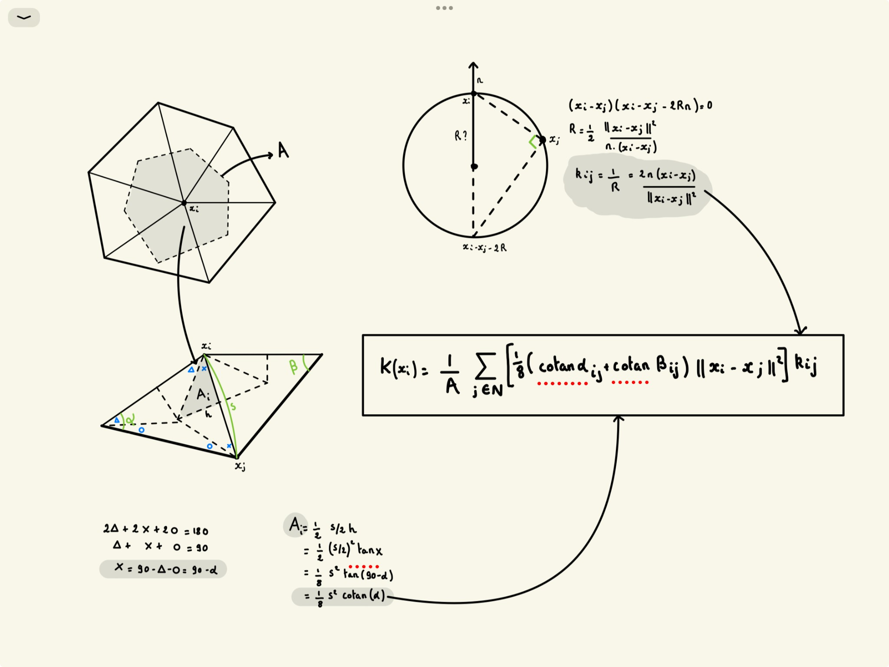
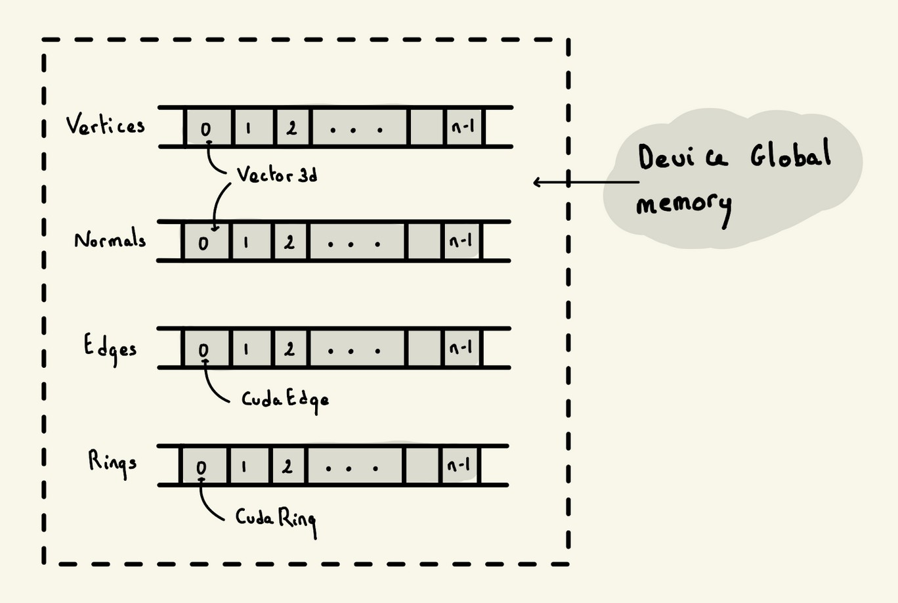
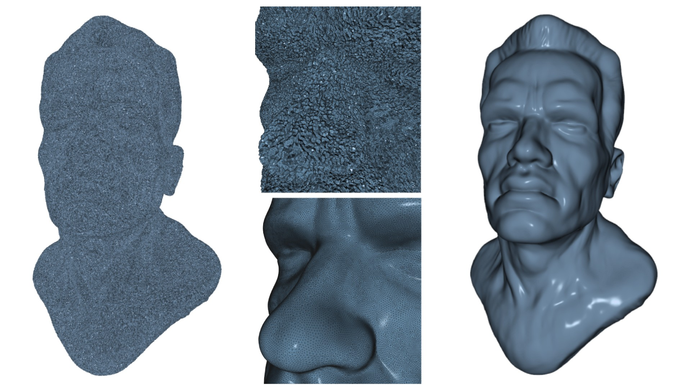

+++
date = '2024-02-19T14:17:30-04:00'
draft = false
title = 'Mean Curvature'
tags = ['gpu', 'cuda', 'geometry']
summary = 'Notes from implementing the mean curvature algorithm from the Meyer et al. paper on the GPU.'
showToc = true
TocOpen = true
cover = { image = 'cover.jpg' }
+++

## Intro

Notes from implementing the mean curvature algorithm of [Discrete Differential-Geometry Operators for Triangulated 2-Manifolds](https://www.multires.caltech.edu/pubs/diffGeoOps.pdf) (Meyer et al.). Curvature is computed per vertex with no dependency between vertices, so the whole thing maps well onto CUDA. I never benchmarked it against a CPU version, so don't read this as a speed comparison.

Code's on [github](https://github.com/vincentlorant/MeanCurvature) if you want to follow along.



## Quick algorithm explanation

The point of this algorithm is anisotropic smoothing: it smooths the surface but keeps features like the sharp angle between the nose and the cheek. A plain Laplacian smooth would eat them.

Each vertex gets a delta D built from its curvature K and a weighted Voronoi area, and moves along its normal by that amount: `v(i) = v(i) + n(i) * k_v(i)`, with `k_v(i)` combining the Voronoi area and the mean curvature of the ring's edges.


## Algorithm implementation

### Procedure

1. Load the mesh, add random noise.
2. Build host rings and edges.
3. Build the CUDA rings and edges, copy them to the device.
4. Copy vertices and normals over.
5. Scale vertices up by the smallest edge length. Depending on the mesh's units, edges can be tiny and the numerics fall apart.
6. Run the curvature kernel n times, n being user-defined.
7. Scale back down.
8. Recompute normals.
9. Copy data back to host and clean buffers.

### Data layout

Everything sits in four contiguous arrays in device global memory.



#### Vertices & Normals

Vertices and normals are `Eigen::Vector3d`, same as open3d, the library I use to load the mesh.

#### CUDA Rings

```cpp
class CudaRing {
    // Rings are characterized by a center vertex ID and pointers to corresponding edges
    VertexId center_;
    CudaEdge *edges_;
    int edges_count_ = 0;

public:
    // Public method to compute the Ring's mean curvature and update the center's position
    __device__ void ComputeCurvature(Eigen::Vector3d *positions,
                                     Eigen::Vector3d *normals);
};
```

#### CUDA Edges

```cpp
struct CudaEdge {
    VertexId end;      // endpoint of an edge in a ring
    VertexId adjs[2]; // adjacent vertices of the {end} vertex in the ring
};
```

### Kernels

Three kernels, that's it.

```cpp
__global__ void OptimizeMeanCurvature(CudaRing *rings, int n,
                                       Eigen::Vector3d *positions,
                                       Eigen::Vector3d *normals) {
    int i = threadIdx.x + blockIdx.x * blockDim.x;
    if (i < n) {
        rings[i].ComputeCurvature(positions, normals);
    }
}

__global__ void GetSmallestEdgesLengths(CudaRing *rings, int n,
                                        Eigen::Vector3d *positions,
                                        double *out) {
    int i = threadIdx.x + blockIdx.x * blockDim.x;
    if (i < n) {
        out[i] = rings[i].GetSmallestEdgeLength(positions);
    }
}

__global__ void ScalePositions(Eigen::Vector3d *positions, int n,
                               float amount) {
    int i = threadIdx.x + blockIdx.x * blockDim.x;
    if (i < n) {
        positions[i] *= amount;
    }
}
```

## Result



(Left - middle-top) the mesh before optimization (middle-bottom - right) the mesh after optimization.

The noise is gone, the anisotropic part does preserve facial features.

On my RTX 3080 the whole thing takes about 1300ms on a 667841-vertex mesh with 30 iterations. The `ComputeCurvature` kernel alone averages 19ms, so 30 iterations only account for about 570ms of that. The rest goes to everything around the kernel: ring construction, host-device copies and scaling passes. 

Expected caveat: quality degrades on meshes with irregular topology, especially with near-degenerate triangles.

## Note

Thanks to [atanazy](https://www.turbosquid.com/3d-models/sculpture-arnold-schwarzenegger-obj-free/856860) for the free model on turbosquid.
